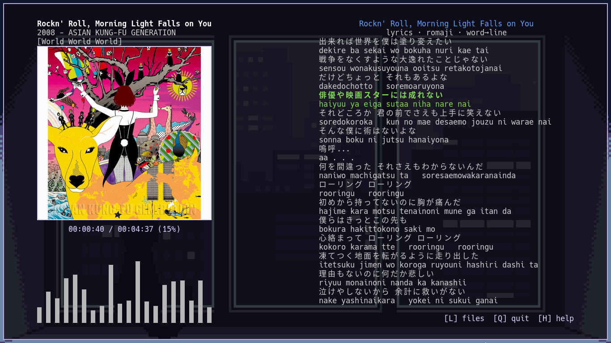

# CWave

Terminal music player for Linux — local files, album covers, a live visualizer, timed lyrics, and optional streaming.

Built around **mpv** (playback), **cava** (visualizer), and **chafa** (covers). The UI is drawn with ANSI escapes in the terminal; no GUI toolkit.

```
┌──────────────────────┬─────────────────────────┐
│  track · cover       │  files  or  lyrics      │
│  ▁▂▃▅▇█ visualizer   │  browser / karaoke      │
└──────────────────────┴─────────────────────────┘
```

---

## Features

### Playback
- Local audio: mp3, flac, ogg, opus, m4a, wav, aac
- Drive playback with **mpv** (gapless-friendly, solid format support)
- Autoplay next track in the current folder / playlist
- Shuffle and **folder loop** (loop is off by default; stops after the last track)
- Seek, pause, resume-from-history (optional)
- **Most Played** virtual folder (symlinks after a play-count threshold)

### Library browser
- Multi-root music directories (`~/Music` by default, configurable)
- Natural sort, parent navigation, keyboard-driven file manager
- Selection restored when leaving a folder (returns to the folder you came from)

### Covers & visualizer
- Album / track art via **chafa** (sixel, kitty, iTerm, or Unicode symbols)
- Optional square crop for 16:9 stream thumbnails
- Real-time **cava** bars on the left (always visible; independent of lyrics)

### Lyrics
- Timed lyrics from **LiriQo** (free multi-provider API, no key)
- Sync levels: **syllable → word → line → plain** (configurable preference; falls down when a level is missing)
- Word-level karaoke highlight (default)
- Toggle the **right panel** between file list and lyrics (`L`) — visualizer stays on the left
- Optional **full-screen lyrics** mode
- Optional **romaji** for Japanese lyrics (`pykakasi`)
- Manual scroll with temporary pause of autoscroll
- Soft-wrap with hyphen continuations (no mid-word ellipsis)
- **Ctrl+C** copy lyrics (plain or with timestamps)
- **Ctrl+V** paste / override lyrics (LRC, enhanced LRC, JSON, or YAML timed formats)
- **Delete** removes cached lyrics for the current track (with confirmation)
- Disk cache under `~/.cache/cwave/lyrics/`

### Streaming (optional)
- Add YouTube / YouTube Music playlist or video URLs for content you own or are authorized to access, while respecting the platform's [Terms of Service](https://www.youtube.com/t/terms).
- Virtual **Stream Playlists** folder; playlists saved as JSON
- Background URL resolve / preload for faster track changes
- Requires **yt-dlp** which must be installed separately.
```
Users are solely responsible for their use of this feature and must ensure that it
complies with applicable copyright laws and the platform's Terms of Service.
CWave Does Not grant permission to download, reproduce, or redistribute copyrighted content.*
```

### Config
- Single file: `~/.config/cwave/config`
- Colors (`#rrggbb` or 256-color), layout, viz size, keybinds, lyrics options
- Versioned config with migration of existing settings

---

## Requirements

### Required
| Package | Role |
|---------|------|
| **mpv** | Playback |
| **cava** | Visualizer |
| **chafa** | Covers |
| **python-mpv** | Python bindings for mpv |
| **mutagen** | Tags from local files |
| **Pillow** | Cover image handling |
| Python **3.10+** | |

### Optional
| Package | Role |
|---------|------|
| **yt-dlp** | Streaming / playlists |
| **pykakasi** | Japanese → romaji |
| **PyYAML** | Paste YAML timed lyrics |
| **wl-clipboard** or **xclip** / **xsel** | Copy / paste lyrics |

---

## Install

Use the bundled installer (same directory as `cwave.py`):

```bash
bash install.sh
```

It asks for your distro (Arch, Debian/Ubuntu/Mint, Fedora, or Other), installs dependencies, optionally installs yt-dlp and pykakasi, then installs the launcher as **`cw`**. Dependencies are installed separately from your system repositories or `pip`; they are not bundled into CWave:

```bash
sudo install -m 755 cwave.py /usr/local/bin/cw
```

Then:

```bash
cw
```

### Manual (Arch example)

```bash
sudo pacman -S --needed mpv cava chafa python-mpv python-mutagen python-pillow wl-clipboard
# optional:
sudo pacman -S --needed yt-dlp python-pykakasi python-yaml

chmod +x cwave.py
sudo cp cwave.py /usr/local/bin/cw
```

---

## Usage

1. Put music under `~/Music` (or set `[directory] paths` in the config).
2. Run `cw`.
3. Browse with ↑ / ↓, open with Enter, go up with Backspace.
4. Press **L** to switch the right column to lyrics while the song plays.
5. Edit `~/.config/cwave/config` for colors, keys, lyrics, and streaming options.

First run writes a default config. Older configs are upgraded and backed up as `config.bak`.

---

## Keybinds

| Key | Action |
|-----|--------|
| **↑ / ↓** | Move selection *(or scroll lyrics when the lyrics panel is open)* |
| **Enter** | Play file / open folder |
| **← / →** | Seek ±N seconds (`seek_seconds` in config) |
| **Space** | Pause / resume |
| **Backspace** | Parent directory |
| **S** | Toggle shuffle *(configurable)* |
| **R** | Toggle folder/playlist loop *(configurable; default off)* |
| **Y** | Add playlist / video URL *(streaming; configurable)* |
| **L** | Toggle right panel: files ↔ lyrics |
| **F** | Full-screen lyrics *(only if `lyrics.fullscreen = true`)* |
| **Ctrl+C** | Copy lyrics *(lyrics panel open)* · otherwise quit |
| **Ctrl+V** | Paste lyrics override *(lyrics panel open)* |
| **Delete** | Delete cached lyrics for this track *(confirm Y/N)* |
| **I** | Track info |
| **H** | Help |
| **Q** | Quit |

While lyrics are shown, file-manager keys (Enter, Backspace, shuffle, add-playlist, etc.) are suspended so navigation doesn’t hit the hidden list.

---

## Config highlights

Path: **`~/.config/cwave/config`**

```ini
[playback]
autoplay = true
shuffle  = false
loop     = false          # R toggles; off = stop after last track
resume   = false

[lyrics]
enable     = true
toggle     = l
romaji     = false        # needs pykakasi
sync       = word         # syllable | word | line | off
max_width  = 0            # 0 = full panel width
copy_timestamps = false
fullscreen = false
fullscreen_key = f

[style]
title_color    = #ffffff
viz_mode       = bars     # bars | blocks | dots | thin
viz_fps        = 60
cover_renderer = auto     # auto | sixel | kitty | iterm | symbols | off
track_display  = {title}\n{year} - {artist}\n[{album}]
```

Music roots:

```ini
[directories]
paths = ~/Music
# paths = ~/Music:~/Downloads/Audio
```

---

## Lyrics notes

- Cache: `~/.cache/cwave/lyrics/`
- API failures or missing tracks show a clear status; instrumental tracks are marked when the API says so
- **Paste formats:** plain text, standard LRC, enhanced (word) LRC, JSON, and YAML with `lines` / `words` / `start_ms`
- YAML paste needs `PyYAML` (`pip install pyyaml` if your distro doesn’t ship it)
- Romaji is opt-in and applied on fetch/paste when enabled

---

## How it works (short)

- **mpv** handles decode and output; CWave drives it over the Python bindings.
- **cava** runs as a subprocess; bar levels are mapped into the left column each frame.
- **chafa** turns cover images into terminal graphics for the current terminal capabilities.
- Lyrics are fetched asynchronously, cached as JSON, and rendered with a dirty-flag / panel cache so the visualizer isn’t stalled by full-column redraws.
- Streaming playlists are stored under `~/.config/cwave/playlists/`; **yt-dlp** resolves page URLs to direct streams (with optional disk TTL cache).

---

## License

CWave is licensed under the **GNU General Public License v3.0 or later**
(**GPL-3.0-or-later**). You may redistribute and/or modify it under the terms
of GPL version 3, or (at your option) any later version. See [`LICENSE`](LICENSE)
for the complete license text.

CWave does not bundle its runtime dependencies. The installer obtains them
separately through your distribution's package manager or, where offered, `pip`.
Those third-party projects remain under their own licenses; the GPL notice for
CWave does not relicense them. When redistributing any third-party component,
follow that component's license and include any notices it requires.

---

## Credits

- [mpv](https://mpv.io/)
- [cava](https://github.com/karlstav/cava)
- [chafa](https://hpjansson.org/chafa/)
- [python-mpv](https://github.com/jaseg/python-mpv) and [Mutagen](https://github.com/quodlibet/mutagen)
- [Pillow](https://python-pillow.org/)
- [yt-dlp](https://github.com/yt-dlp/yt-dlp) (optional)
- Lyrics via [LiriQo](https://github.com/AlFarrizi-Studio/LiriQo.git) multi-provider API
